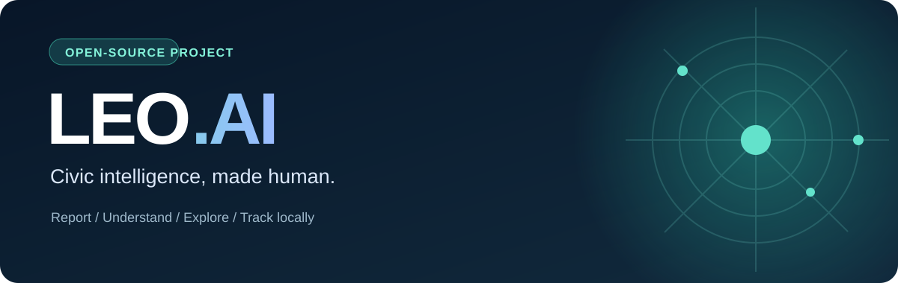

<div align="center">



# LEO.AI

**A multilingual, AI-assisted civic issue reporting prototype for India.**

<p>
  
  
  
  
  <a href="https://github.com/svsramakrishnanaidu-rgb/leo-ai/actions/workflows/quality.yml"></a>
</p>

[Explore the application](#application-tour) · [Get started](#quick-start) · [Architecture](#how-it-works) · [Security](#security--data-handling)

</div>

---

## Why LEO.AI?

Civic issues—damaged roads, overflowing waste, broken streetlights and water leaks—can be difficult to describe and categorize. **LEO.AI explores a simpler reporting experience** that helps people prepare a structured complaint, explore nearby reports, and understand which type of department may be relevant.

> [!IMPORTANT]
> **Independent prototype—not an official government platform.** Reports and status timelines in this repository are stored locally in your browser, with sample data for demonstration. Using LEO.AI does **not** submit a complaint to a municipality or notify a government department.

## Application tour

| Area | What it does |
| --- | --- |
| **Report an issue** | Guided complaint creation, issue categorization and suggested department |
| **LEO assistant** | Conversational help with civic issues; local fallback responses when AI service is unavailable |
| **Map** | Interactive map experience using Leaflet and OpenStreetMap |
| **Track** | View saved complaint details and status within the local prototype |
| **Dashboard** | Explore reports through charts and summary views |
| **Accessibility** | Dedicated accessibility information and inclusive design features |
| **Languages** | English, Telugu and Hindi text support |

**AI behavior:** The app can use Groq for classification and chat when configured. Without an API key, it uses built-in rule-based responses and classification.

## Tech stack

| Layer | Technologies |
| --- | --- |
| UI | React 19, TypeScript, Vite 8 |
| Styling & motion | Tailwind CSS 4, Framer Motion, Lucide React |
| Maps | Leaflet, React Leaflet, OpenStreetMap / Nominatim |
| Charts | Recharts |
| AI | Optional Groq API; deterministic local fallback |
| Prototype data | Browser `localStorage` |

## Quick start

**Prerequisites:** Node.js compatible with Vite 8 (Node 22.12+ or 20.19+) and npm.

```bash
git clone https://github.com/svsramakrishnanaidu-rgb/leo-ai.git
cd leo-ai
npm ci
npm run dev
```

Open the local URL printed by Vite.

| Command | Purpose |
| --- | --- |
| `npm run dev` | Start the development server |
| `npm run build` | Type-check and create a production build |
| `npm run preview` | Preview the production build |
| `npm run lint` | Run Oxlint |

### AI configuration and API key safety

No key is required to explore the UI or local fallback behavior.

**Never put a production Groq API key in a `VITE_*` variable.** Vite exposes these values in the client bundle, so users of a deployed website can extract them. The current prototype's optional Groq integration makes requests from the browser, and **must be moved behind a server-side API or edge function before deploying with a real secret**. Do not commit `.env` or secrets, and rotate any key that has already been exposed.

For details, see [SECURITY.md](./SECURITY.md).

## How it works

```text
Browser (React + TypeScript)
  ├─ Report → classify issue → draft complaint
  │    ├─ Groq (optional; current prototype uses browser-side requests)
  │    └─ Local keyword-based fallback
  ├─ Track / Dashboard / Map → read browser-local report data
  ├─ Map & location search → Leaflet / OpenStreetMap / Nominatim
  └─ Language and accessibility preferences
```

**Data limitation:** Records are stored in the browser where they were created. They are not shared with other users or synced to an official system. Example complaints and status updates are illustrative, not proof of municipal action.

## Repository guide

```text
src/
  components/   reusable interface and layout
  lib/          AI, chatbot, i18n, geocoding and local storage
  pages/        home, report, track, map, dashboard and accessibility
  types/        shared TypeScript types
public/         icons and public assets
docs/assets/    repository presentation assets
```

## Roadmap

- [ ] Proxy all AI requests through a secure backend
- [ ] Add authenticated, shared storage and clear report provenance
- [ ] Add automated tests and accessibility audits
- [ ] Publish verified screenshots and a walkthrough
- [ ] Integrate an authorized complaint submission workflow before claiming official reporting

## Contribute

Suggestions, issues and pull requests are welcome. See [CONTRIBUTING.md](./CONTRIBUTING.md).

## Project creator

**Sandu Venkata Siva Ramakrishna** · [GitHub](https://github.com/svsramakrishnanaidu-rgb)

<p align="center"><sub>Designed to make civic reporting easier to understand. Built as an independent learning and demonstration project.</sub></p>
